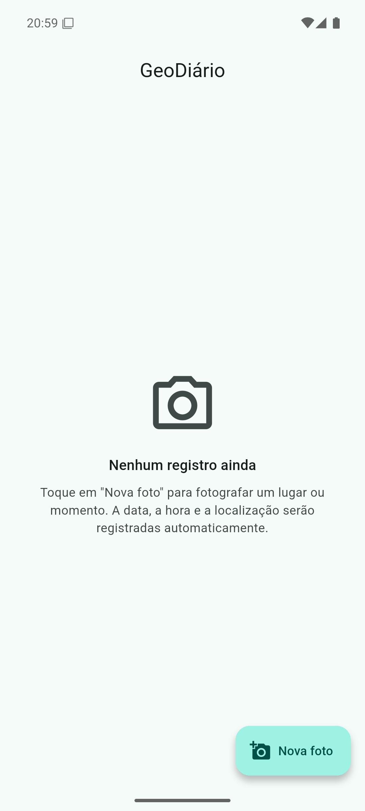
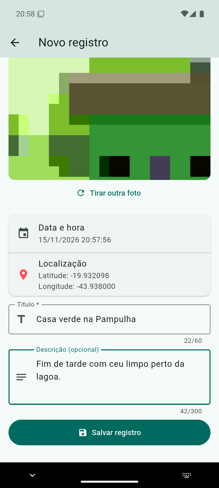
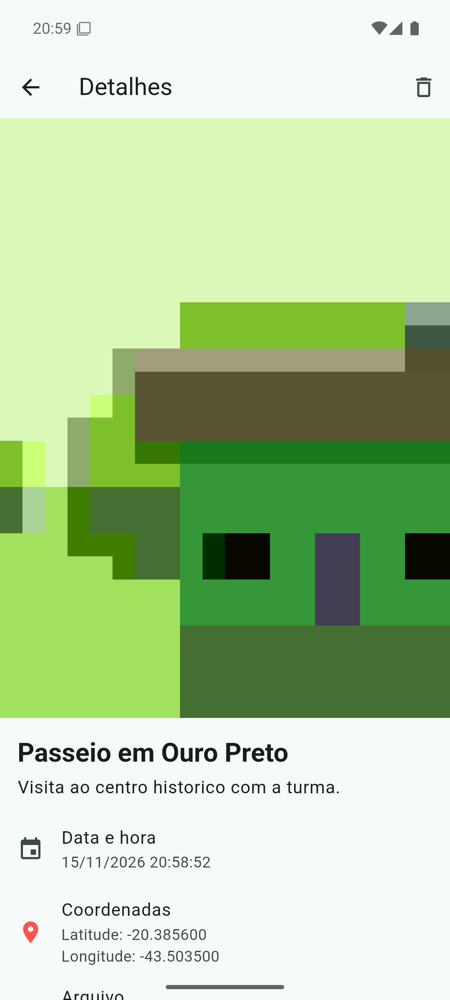

# GeoDiário

Aplicativo feito em Flutter para a atividade prática de Desenvolvimento Mobile. A ideia é registrar fotos de lugares ou momentos do dia a dia junto com a data, a hora e a localização (latitude e longitude) de onde a foto foi tirada. Tudo fica salvo no próprio celular usando SQLite.

## Funcionalidades

**Captura de foto (RF01):** ao tocar em "Nova foto" o app já abre a câmera. Depois de tirar a foto dá para trocar por outra antes de salvar.

**Informações do registro (RF02):** quando a foto é tirada, o app guarda a data e a hora e busca a posição no GPS. Se o GPS estiver desligado ou a permissão for negada, aparece uma mensagem com a opção de tentar de novo (ou de abrir as configurações, se a permissão foi negada de vez). O usuário preenche um título, que é obrigatório, e uma descrição, que é opcional.

**Armazenamento local (RF03):** o `image_picker` salva a foto numa pasta temporária, então o app copia o arquivo para a pasta de documentos do aplicativo (`fotos/geo_<timestamp>.jpg`). No banco fica salvo o caminho desse arquivo junto com os outros dados.

**Consulta (RF04):** a tela inicial mostra os registros em uma galeria (grade com a foto, o título e a data), do mais recente para o mais antigo.

**Visualização e exclusão (RF05):** tocando em um registro abre a tela de detalhes com a foto maior e todas as informações. Pelo ícone de lixeira é possível excluir. O app pede confirmação e apaga tanto a linha do banco quanto o arquivo da foto.

Das operações de CRUD, foram implementadas inclusão, consulta e exclusão, que são as pedidas no enunciado.

## Bibliotecas utilizadas

| Pacote | Para que foi usado |
|---|---|
| `image_picker` | Abrir a câmera e tirar a foto |
| `geolocator` | Pedir permissão de localização e pegar latitude e longitude |
| `sqflite` | Banco de dados SQLite |
| `path` | Montar os caminhos do banco e das fotos |
| `path_provider` | Descobrir a pasta de documentos do app, onde as fotos ficam |
| `provider` | Gerenciar o estado da lista de registros |
| `intl` | Formatar data e hora (dd/MM/yyyy HH:mm:ss) |

## Estrutura da tabela SQLite

O banco se chama `geodiario.db` e tem uma tabela, `registros`:

```sql
CREATE TABLE registros (
  id            INTEGER PRIMARY KEY AUTOINCREMENT,
  titulo        TEXT    NOT NULL,
  descricao     TEXT,
  caminho_foto  TEXT    NOT NULL,
  data_hora     TEXT    NOT NULL,
  latitude      REAL    NOT NULL,
  longitude     REAL    NOT NULL
);
```

| Coluna | Tipo | Descrição |
|---|---|---|
| id | INTEGER | Chave primária, gerada automaticamente |
| titulo | TEXT | Título digitado pelo usuário (obrigatório) |
| descricao | TEXT | Descrição opcional |
| caminho_foto | TEXT | Caminho do arquivo da foto no celular |
| data_hora | TEXT | Data e hora da foto em formato ISO 8601, ex.: 2026-11-15T17:30:12 |
| latitude | REAL | Latitude obtida pelo GPS |
| longitude | REAL | Longitude obtida pelo GPS |

A imagem não é gravada dentro do banco, só o caminho dela.

## Organização do código

```
lib/
  main.dart                       inicia o app e o Provider
  models/registro.dart            classe Registro (toMap e fromMap)
  database/database_helper.dart   abre o banco, cria a tabela e faz insert, select e delete
  services/camera_service.dart    tira a foto, copia para a pasta do app e apaga o arquivo
  services/location_service.dart  permissões e leitura do GPS
  providers/registros_provider.dart  lista de registros (ChangeNotifier)
  views/galeria_screen.dart       tela inicial com a galeria
  views/novo_registro_screen.dart tela de novo registro
  views/detalhe_screen.dart       tela de detalhes e exclusão
  components/registro_card.dart   cartão usado na galeria
  components/foto_registro.dart   mostra a foto a partir do arquivo
  utils/formatadores.dart         formatação de data e coordenadas
test/
  registro_test.dart              testes da conversão do modelo para a tabela
```

Segui a mesma divisão de pastas do exemplo de CRUD com sqflite visto em aula (models, provider, views e components). As telas não acessam o banco direto: elas chamam o provider, e o provider usa o `DatabaseHelper` e os serviços.

## Capturas de tela

Os prints foram tirados no emulador do Android Studio (Pixel 7, Android 15). A câmera do emulador mostra uma cena virtual, por isso as fotos são dessa casinha. A localização foi definida pelo próprio emulador (Pampulha, em BH, e Ouro Preto).

| Galeria vazia | Novo registro | Galeria |
|:---:|:---:|:---:|
|  |  |  |

| Detalhes | Exclusão |
|:---:|:---:|
|  |  |

## Permissões

No Android (`android/app/src/main/AndroidManifest.xml`):

```xml
<uses-permission android:name="android.permission.CAMERA" />
<uses-permission android:name="android.permission.ACCESS_FINE_LOCATION" />
<uses-permission android:name="android.permission.ACCESS_COARSE_LOCATION" />
```

No iOS foram adicionadas no `Info.plist` as mensagens `NSCameraUsageDescription`, `NSPhotoLibraryUsageDescription` e `NSLocationWhenInUseUsageDescription`.

## Como rodar

Precisa do Flutter instalado e de um celular Android ou emulador. Não funciona na versão web porque o sqflite não tem suporte para web.

```bash
flutter pub get
flutter run
```

No emulador, para mudar a localização: abra os controles estendidos (botão "..." na barra lateral), vá em Location, escolha um ponto no mapa e clique em "Set location".

Para rodar os testes:

```bash
flutter test
```

Versão usada no desenvolvimento: Flutter 3.50 (stable).
