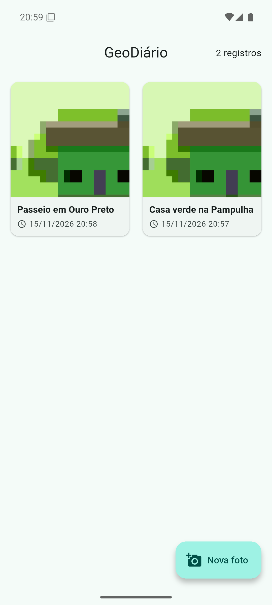
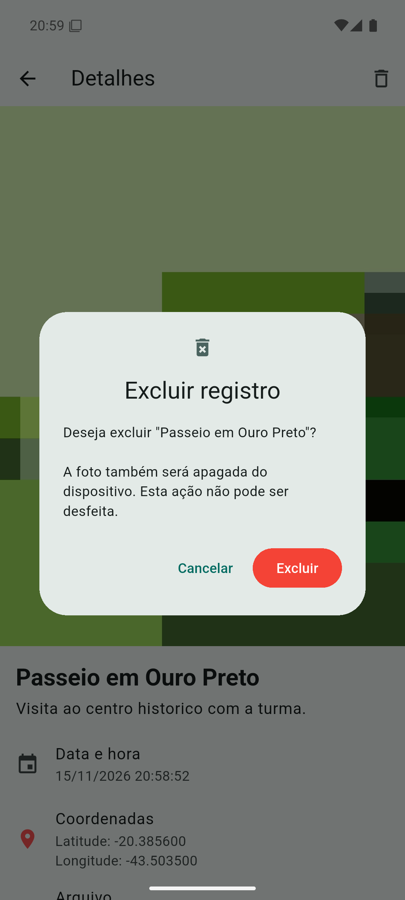

# GeoDiário 📍📷

Aplicativo móvel desenvolvido em **Flutter/Dart** para registrar fotografias associadas automaticamente à **data, ao horário e à localização geográfica (GPS)** em que foram capturadas. Os registros são armazenados localmente com **SQLite** (`sqflite`).

> Atividade prática da disciplina de Desenvolvimento Mobile.

---

## Funcionalidades implementadas

| Requisito | Funcionalidade | Onde está no código |
|---|---|---|
| **RF01** – Captura de fotografia | Abre a câmera do dispositivo (automaticamente ao entrar na tela *Novo registro*) e permite tirar outra foto antes de salvar. | `services/camera_service.dart` → `tirarFoto()` |
| **RF02** – Informações do registro | No momento da captura o app registra **data e hora** e obtém **latitude e longitude** pelo GPS, tratando serviço desativado, permissão negada e negada permanentemente (com atalho para as configurações). O usuário informa um **título** (obrigatório) e uma **descrição** (opcional). | `services/location_service.dart`, `views/novo_registro_screen.dart` |
| **RF03** – Armazenamento local | A foto é copiada da pasta temporária do `image_picker` para a pasta de documentos do app (`<documentos>/fotos/geo_<timestamp>.jpg`). O banco SQLite guarda o **caminho** do arquivo e os demais dados. | `services/camera_service.dart` → `salvarFotoPermanente()`, `database/database_helper.dart` |
| **RF04** – Consulta dos registros | Tela inicial em formato de **galeria** (grade com miniatura, título e data), ordenada do registro mais recente para o mais antigo, com estado vazio e *pull-to-refresh*. | `views/galeria_screen.dart`, `components/registro_card.dart` |
| **RF05** – Visualização e exclusão | Ao tocar em um registro, exibe a foto ampliada e todas as informações (título, descrição, data/hora, coordenadas e caminho do arquivo). O botão de lixeira pede confirmação e **exclui o registro do banco e o arquivo de imagem** do dispositivo. | `views/detalhe_screen.dart`, `providers/registros_provider.dart` → `excluir()` |

Operações CRUD implementadas: **Create** (inserir), **Read** (listar/consultar) e **Delete** (excluir).

---

## Bibliotecas utilizadas

| Pacote | Uso |
|---|---|
| [`image_picker`](https://pub.dev/packages/image_picker) | Captura de fotos com a câmera do dispositivo |
| [`geolocator`](https://pub.dev/packages/geolocator) | Permissões de localização e obtenção de latitude/longitude |
| [`sqflite`](https://pub.dev/packages/sqflite) | Banco de dados SQLite local |
| [`path`](https://pub.dev/packages/path) | Montagem de caminhos de arquivos (banco e fotos) |
| [`path_provider`](https://pub.dev/packages/path_provider) | Localização da pasta de documentos do app, onde as fotos são guardadas |
| [`provider`](https://pub.dev/packages/provider) | Gerenciamento de estado (`ChangeNotifier`) |
| [`intl`](https://pub.dev/packages/intl) | Formatação de data e hora (`dd/MM/yyyy HH:mm:ss`) |

---

## Estrutura da tabela SQLite

Banco: `geodiario.db` — Tabela: **`registros`**

```sql
CREATE TABLE registros (
  id            INTEGER PRIMARY KEY AUTOINCREMENT,
  titulo        TEXT    NOT NULL,
  descricao     TEXT,
  caminho_foto  TEXT    NOT NULL,
  data_hora     TEXT    NOT NULL,
  latitude      REAL    NOT NULL,
  longitude     REAL    NOT NULL
);
```

| Coluna | Tipo | Descrição |
|---|---|---|
| `id` | INTEGER (PK, autoincremento) | Identificador do registro |
| `titulo` | TEXT, obrigatório | Título informado pelo usuário |
| `descricao` | TEXT | Descrição opcional |
| `caminho_foto` | TEXT, obrigatório | Caminho do arquivo da foto no armazenamento local do app |
| `data_hora` | TEXT, obrigatório | Data e hora da captura no formato ISO 8601 (ex.: `2026-11-15T17:30:12.000`) |
| `latitude` | REAL, obrigatório | Latitude obtida pelo GPS |
| `longitude` | REAL, obrigatório | Longitude obtida pelo GPS |

> A imagem **não** é gravada dentro do banco (BLOB): o banco armazena apenas o caminho, e o arquivo fica na pasta de documentos do aplicativo.

---

## Organização do código

```
lib/
├── main.dart                        # Ponto de entrada: MaterialApp + Provider
├── models/
│   └── registro.dart                # Modelo Registro (toMap / fromMap)
├── database/
│   └── database_helper.dart         # Conexão SQLite, criação da tabela e CRUD
├── services/
│   ├── camera_service.dart          # Captura, cópia e exclusão de fotos
│   └── location_service.dart        # Permissões e leitura do GPS
├── providers/
│   └── registros_provider.dart      # Estado da lista (ChangeNotifier)
├── views/
│   ├── galeria_screen.dart          # RF04 – galeria de registros
│   ├── novo_registro_screen.dart    # RF01/RF02/RF03 – novo registro
│   └── detalhe_screen.dart          # RF05 – visualização e exclusão
├── components/
│   ├── registro_card.dart           # Cartão da galeria
│   └── foto_registro.dart           # Exibição da foto a partir do arquivo local
└── utils/
    └── formatadores.dart            # Formatação de data/hora e coordenadas
test/
└── registro_test.dart               # Testes do modelo (conversão para a tabela)
```

Fluxo das camadas: **views → provider → database / services**. As telas não acessam o banco diretamente.

---

## Capturas de tela

Capturas feitas em emulador Android 15 (Pixel 7). A câmera do emulador fotografa uma cena virtual, e as coordenadas foram definidas pelo controle de localização do emulador (Pampulha, em Belo Horizonte, e Ouro Preto).

| Galeria vazia | Novo registro (RF01/RF02) | Galeria (RF04) |
|:---:|:---:|:---:|
|  |  |  |
| Estado inicial, sem registros | Foto, data/hora e GPS preenchidos automaticamente; título e descrição informados pelo usuário | Registros salvos no SQLite, do mais recente para o mais antigo |

| Detalhe (RF05) | Exclusão (RF05) |
|:---:|:---:|
|  |  |
| Foto ampliada com título, descrição, data/hora, coordenadas e caminho do arquivo | Confirmação antes de apagar o registro do banco e o arquivo da foto |

---

## Permissões

**Android** (`android/app/src/main/AndroidManifest.xml`):

```xml
<uses-permission android:name="android.permission.CAMERA" />
<uses-permission android:name="android.permission.ACCESS_FINE_LOCATION" />
<uses-permission android:name="android.permission.ACCESS_COARSE_LOCATION" />
```

**iOS** (`ios/Runner/Info.plist`): `NSCameraUsageDescription`, `NSPhotoLibraryUsageDescription` e `NSLocationWhenInUseUsageDescription`.

---

## Como executar

Pré-requisitos: Flutter SDK e um dispositivo Android (físico ou emulador). O `sqflite` **não** funciona na versão Web, então o app deve ser executado em Android ou iOS.

```bash
flutter pub get
flutter run
```

Para testar no **emulador Android**:
- **Câmera:** o emulador oferece uma câmera virtual (cena 3D) para fotografar.
- **GPS:** em *Extended controls (⋯) → Location*, escolha um ponto no mapa e clique em **Set location**.

Testes automatizados:

```bash
flutter test
```

Desenvolvido e testado com Flutter 3.50 (stable) em emulador Android 15 (API 35).
